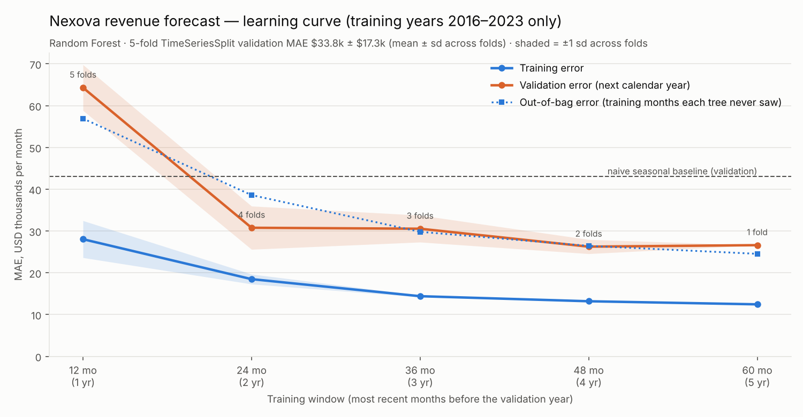

# Technical evaluation — Nexova monthly revenue forecast (Random Forest)

**Ticket:** formal evaluation before promoting the sales forecast model to staging.
**Model evaluated:** `scripts/train_sales_forecast.py` as shipped in PR #24, with the same features, the same settings (`n_estimators=300`, `min_samples_leaf=2`, `max_features=0.6`) and `random_state=42`.
**Data:** `data/raw/nexova_sales.csv` (identical to the dataset provided with the Nexova briefing), `consolidated` rows, target `revenue_usd`. The evaluation uses **only the training years, 2016-01 → 2023-12**. The 2024–2025 test years are never loaded into a fold, so this evaluation cannot leak into the final test result.
**Reproduce:** `uv run python scripts/evaluate_sales_forecast.py` · tests: `uv run pytest tests/pipelines/test_model_evaluation.py -v`

## Verdict

| Ticket question | Answer |
|---|---|
| Underfitting, overfitting or well fitted? | **Reasonably well fitted.** Validation error levels off at about **$26k per month (≈3% of an average month)**. That's 39% better than a naive seasonal forecast, and it matches the model's own out-of-bag error, so the train/validation gap isn't memorisation. |
| How stable is it when the training window changes? | **Stable once it has at least 2 years of feature rows:** validation MAE **$26.1k ± $1.5k** across folds 2–5 (3.09% ± 0.18% of a month). **Unstable below that.** Trained on 12 months, validation error more than doubles (**$64.6k**), which inflates the 5-fold result to **$33.8k ± $17.3k**. |
| Specific corrective action | **Don't add complexity or regularisation, and don't add features.** Enforce a **minimum training window of 24 feature months** (48 calendar months including the lag warm-up) and retrain on an expanding window. That guard is now coded in `train_model`. |

## 1. Time-aware cross-validation

- **Strategy:** `TimeSeriesSplit(n_splits=5, test_size=12)` over the 72 feature rows of the training years (2018-01 → 2023-12; the first 24 months are lag warm-up). Each validation fold is exactly one calendar year, so each contains a full August dip and January–February peak. The training window is everything before it (an expanding window).
- **No shuffling:** indices are strictly increasing inside every fold. Every training index precedes every validation index, and no index from a later fold appears before one from an earlier fold. `tests/pipelines/test_model_evaluation.py` asserts all three.
- **No leakage across the fold boundary:** every feature for month *t* (lags 1/2/12, 3-month rolling mean, 12-month CV, trailing year-over-year growth, and the trailing-12-month mean used for scaling) is computed from months before *t* only. Each fold rebuilds its feature frame from the series **cut off at the end of its validation year**, so no later value exists in memory while the fold is scored. The tests also triple the revenue of each validation year and check that no training-row feature or target changes.
- **Validation forecasts are one-step-ahead:** each month's features use actual revenue up to the month before, which is how a monthly rolling forecast runs.

### Results per fold (USD per month)

| Fold | Train window | Validation year | Train months | Train MAE | Train RMSE | OOB MAE | **Val MAE** | **Val RMSE** |
|---|---|---|---|---|---|---|---|---|
| 1 | 2018-01 → 2018-12 | 2019 | 12 | $21,109 | $33,135 | $45,342 | **$64,603** | **$81,904** |
| 2 | 2018-01 → 2019-12 | 2020 | 24 | $18,689 | $25,833 | $38,117 | **$24,825** | **$34,748** |
| 3 | 2018-01 → 2020-12 | 2021 | 36 | $14,174 | $18,059 | $30,046 | **$27,924** | **$30,197** |
| 4 | 2018-01 → 2021-12 | 2022 | 48 | $13,202 | $15,906 | $26,562 | **$25,048** | **$29,414** |
| 5 | 2018-01 → 2022-12 | 2023 | 60 | $12,443 | $15,157 | $24,530 | **$26,605** | **$32,105** |

### Mean ± standard deviation across folds

| | Train MAE | **Validation MAE** | Train RMSE | **Validation RMSE** |
|---|---|---|---|---|
| All 5 folds | $15,923 ± $3,779 | **$33,801 ± $17,265** (4.14% ± 2.35%) | $21,618 ± $7,705 | **$41,674 ± $22,583** (5.12% ± 3.07%) |
| Folds 2–5 (≥ 24 training months) | $14,627 ± $2,799 | **$26,101 ± $1,451** (3.09% ± 0.18%) | $18,739 ± $4,887 | **$31,616 ± $2,374** (3.76% ± 0.45%) |
| Naive seasonal baseline* | — | $43,042 ± $4,725 | — | $49,131 ± $4,141 |

\*Same month last year × last year's growth, scored on the same 5 validation years. It's the "no model" reference.

Percentages are relative to the average monthly revenue of each validation year. Full detail is in `data/eval/model_evaluation/cv_folds.csv`.

## 2. Learning curve

`data/eval/learning_curve.png`. For each training size (12 to 60 months), the model is trained on the months immediately before each validation year that has enough history, and the errors are averaged across those folds. The dotted line is the **out-of-bag (OOB) error**: each training month scored only by the trees that did *not* see it during training.

| Training window | Train MAE | OOB MAE | Validation MAE |
|---|---|---|---|
| 12 months | $28,032 | $56,902 | **$64,303** |
| 24 months | $18,474 | $38,589 | **$30,768** |
| 36 months | $14,392 | $29,799 | **$30,541** |
| 48 months | $13,181 | $26,438 | **$26,246** |
| 60 months | $12,443 | $24,530 | **$26,605** |

**What the pattern shows:**

1. **Validation error falls steeply, then flattens.** It halves from 12 to 24 months ($64k → $31k), then barely moves ($31k → $26k), and 48 and 60 months are equal. More history of the same kind gives almost nothing beyond 4 years. The model has learned the pattern that's learnable from this series.
2. **The curves settle at a low error.** $26k is about 3% of a ~$850k month, 39% below the naive baseline, and inside the ±5% band CONTEXT.md describes for non-seasonal months.
3. **The gap is in-sample optimism, not memorisation.** Training MAE ($12–13k) is the error on months the trees were fitted on, which is always optimistic for a Random Forest. The honest in-window error (OOB) converges onto the validation curve ($26.4k vs $26.2k at 48 months; $24.5k vs $26.6k at 60). An overfitted model would show OOB staying far below validation, because it would fit patterns that don't hold in the next year. That doesn't happen here.
4. **It isn't underfitting either.** Underfitting means both curves converge at a *high* error. Here the converged error is low, beats the baseline by a wide margin, and predicts August as the weakest month in every fold with at least 24 training months. The training error keeps falling as data grows, so the model has enough capacity.

## 3. Was the gap worth fixing? Complexity check

`min_samples_leaf` is the main capacity setting of a Random Forest. Each value was re-scored with the same 5-fold CV (`data/eval/model_evaluation/complexity_sweep.csv`):

| `min_samples_leaf` | Train MAE | OOB MAE | Validation MAE (mean ± sd) | Val / train |
|---|---|---|---|---|
| 1 (most complex) | $10,938 | $30,824 | $32,006 ± $14,390 | 2.93 |
| **2 (production)** | **$15,923** | **$32,919** | **$33,801 ± $17,265** | **2.12** |
| 3 | $21,518 | $35,487 | $37,502 ± $14,507 | 1.74 |
| 5 | $34,727 | $44,293 | $48,530 ± $13,137 | 1.40 |
| 8 | $45,207 | $51,726 | $53,881 ± $8,947 | 1.19 |
| 12 (most regularised) | $52,201 | $56,353 | $58,439 ± $6,023 | 1.12 |

- **More regularisation makes the model worse.** Raising `min_samples_leaf` shrinks the train/validation gap, but only by raising *both* errors. Validation MAE gets worse at every step (+11% at 3, +44% at 5, +73% at 12). That's the signature of a gap that isn't overfitting; closing it would push the model into underfitting.
- **More complexity doesn't pay either.** `min_samples_leaf=1` is $1.8k better on average, but on folds 2–5 it's $25.7k ± $3.5k against $26.1k ± $1.5k: the same accuracy with more than twice the fold-to-fold spread. Production stays at 2.
- **A new feature didn't help.** Validation bias flips sign each year (it under-forecasts the high-growth years 2019, 2021 and 2023 and over-forecasts the low-growth years 2020 and 2022), which matches the alternating growth pattern in CONTEXT.md. I tested a causal "growth so far this year" feature (last 3 months vs the same months a year earlier) on the same folds. It changed validation MAE on folds 2–5 from $26.1k to $26.0k, which is noise. The growth regime of a new year can't be predicted from data available before that year starts, so this isn't recommended.

## 4. Metrics: MAE and RMSE

Both are reported above for training and validation, in USD per month.

- **MAE** (mean absolute error): the average size of a monthly miss in dollars. Every dollar of error counts the same. Folds 2–5: **$26.1k ± $1.5k**.
- **RMSE** (root mean squared error): squares each miss before averaging, so one big miss costs more than several small ones. Folds 2–5: **$31.6k ± $2.4k**.
- **RMSE / MAE = 1.21 on folds 2–5** (1.23 over all 5). If every miss were the same size, RMSE would equal MAE. A ratio near 1.2 means the errors are fairly even, with no single disaster month. Fold 1's ratio of 1.27 comes from its few large misses, which RMSE amplifies.

### Primary metric: RMSE, with MAE as the plain-language companion

**What the Nexova briefing says about the cost of errors:**

- **It doesn't say over-forecasting costs more than under-forecasting, or the reverse.** Both errors are treated as equally costly, and MAE and RMSE are both symmetric, so neither is favoured on that account. The direction is tracked separately as **bias**: −$6.6k ± $20.3k over the 5 folds, alternating with the growth regime as described in section 3, so there's no systematic lean either way.
- **What it does say:** Laura needs to *"confidently tell apart a normally-slow month (typical in August) from an anomalous drop that deserves immediate attention."* That makes **large single-month misses** the expensive error. A forecast that is off by $80k in one month either raises a false alarm on a normal month or hides a real drop. A forecast that is off by $25k every month does neither. MAE weighs those two cases the same way; RMSE doesn't.
- **It also asks for MSE in USD² and as a percentage of average monthly revenue,** so Marcos and Laura can read it directly. RMSE is the square root of that MSE, back in dollars, and it's the "±3% of an average month" figure already given to Finance in PR #24. Using it here keeps one consistent error measure from feasibility to staging.

**So RMSE is the primary metric.** It's the one that gets worse when the model produces the occasional large miss that would break Laura's "normal August vs real drop" reading, and fold 1 shows the difference: its RMSE/MAE ratio of 1.27 is the highest of the five folds because of exactly those large misses.

**MAE goes next to it in every report** because it's the easiest number for Marcos and Laura to read: "on average the forecast is off by about $26k a month." The **promotion gate** in section 5 is set on validation RMSE as well: ≤ **$36k** (folds 2–5: $31.6k + 2 × $2.4k), alongside the MAE gate.

## 5. Corrective action

**Root cause of the only problem found:** with 12 months of feature rows, the model sees each calendar month once and only one growth regime (2018 was a low-growth year). In fold 1 it then under-forecast 9 of the 12 months of the high-growth year 2019 (average bias −$35k a month), missed by $64.6k on average, and even predicted May rather than August as the weakest month. It hadn't learned the summer slowdown from a single example. From 24 months on, it has seen both regimes and every calendar month at least twice. It then picks August as the weakest month in every fold, and the error drops to the stable ~$26k.

**Action (implemented in this PR):**

1. `MIN_TRAIN_FEATURE_MONTHS = 24` in `scripts/train_sales_forecast.py`. `train_model` raises a `ValueError` if asked to fit on fewer than 24 feature months, which is 48 calendar months of `revenue_usd` including the 24-month lag warm-up. It's covered by two unit tests.
2. Production retraining uses an **expanding window** (all history from 2016), never a short rolling window. The current model trains on 72 feature months, well above the minimum, so its test results in `data/eval/sales_forecast/metrics.json` are unchanged.
3. **No change** to `min_samples_leaf`, `max_features` or the feature set, for the reasons in section 3.

**Promotion gate for staging:** on each retrain, rerun this evaluation. Only promote if the folds with ≥ 24 training months give validation **RMSE ≤ $36k** (the primary metric; current mean + 2 sd) and **MAE ≤ $29k**, and no fold is worse than the naive seasonal baseline (MAE $43k).

**Recommendation:** approve for staging.

## Limitations

- 72 monthly feature rows give only 5 validation years, so the standard deviations rest on 4–5 numbers.
- The learning-curve points at 48 and 60 months come from 2 folds and 1 fold, because only the latest folds have that much history.
- The dataset is very regular. Real-world error will be higher, which is why the promotion gate reruns this evaluation on every retrain.
