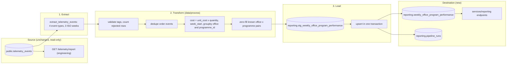

# Business Performance Data Pipeline: Design (Nexova)

| | |
|---|---|
| **Status** | Design only. No orchestration code, migrations or scripts are part of this change. |
| **Pipeline** | `weekly-office-performance` |
| **Company** | Nexova (HR consulting, offices in Valencia and Miami) |
| **Date** | 2026-10-11 |
| **Future code** | `data/pipelines/weekly_office_performance/` (orchestration), `data/process/` (transformations), `services/api/app/reporting/` (HTTP) |

> Repo note: the FastAPI backend lives in `services/api/app/` in this monorepo, so the brief's `services/telemetry/` and `services/reporting/` map to `services/api/app/telemetry/` and `services/api/app/reporting/`.

## 1. Current state

### 1.1 What telemetry captures

The backoffice emits events through a single `track()` function (`uis/backoffice/lib/telemetry.ts`). They are sent in batches to `POST /telemetry/events`, which validates each event and stores the valid ones with one bulk insert.

| Group | event_type |
|---|---|
| Mandatory (telemetry CONTEXT) | `inbound_order_created`, `outbound_order_created`, `stock_threshold_triggered`, `direct_stock_edit_rejected`, `kit_cost_variance_detected` |
| Identified in our plan | `backoffice_section_viewed`, `api_latency_recorded`, `api_request_failed`, `validation_error_raised`, `frontend_error_raised`, `login_succeeded`, `login_failed`, `session_expired` |
| Planned, not instrumented | `incident_created`, `product_created`, `report_exported` |

### 1.2 Where it is stored

Events land in `public.telemetry_events`, which is append-only.

| Column | Type | Content |
|---|---|---|
| `id` | uuid | row id |
| `timestamp` | timestamptz | event time as captured in the browser, UTC |
| `service` | text | `backoffice` |
| `event_type` | text | `entity_action` name |
| `level` | text | `info`, `warn` or `error` |
| `value` | numeric | one optional numeric property, for example `quantity` |
| `message` | text | unused |
| `tags` | jsonb | the event's allowlisted `properties` |

Indexes: `timestamp`, `event_type` and a GIN index on `tags`. The envelope fields `eventId`, `sessionId`, `userId` and `requestId` are not stored.

Example `tags` of an `inbound_order_created` row:

```json
{"office": "valencia", "currency": "EUR", "order_id": "9", "quantity": 5, "unit_cost": 14,
 "product_id": "NXV-IT-001", "product_category": "onboarding_equipment",
 "programme_id": "support-onboarding", "supplier_id": "techdistrib-valencia-s-l"}
```

### 1.3 What the technical report answers

`GET /telemetry/report` (`services/api/app/telemetry/analysis.py`, cached for 60 seconds) serves engineering with five operational metrics: `events_per_day`, `error_rate_by_day`, `error_rate_by_type`, `event_type_distribution` and `api_latency_by_endpoint`. This path stays unchanged.

### 1.4 The business gap

| Business question (data-pipelines CONTEXT) | Answered by the technical report? |
|---|---|
| How much did each office spend on material, per programme, this week? | No. It never reads cost, office or programme. |
| How many kits did each office deliver, per programme? | No. It counts events by type and day only. |
| How often did a programme's stock run below the minimum? | No. No office or programme dimension. |
| How often did a supplier's unit cost spike? | No. Same reason. |

The report groups by day and by event type. It does not read the `tags` dimensions (`office`, `programme_id`, `currency`), has no weekly grain and never aggregates cost. Nobody tracks these numbers centrally across Valencia and Miami today, so Laura and Elena depend on a hand-assembled report. A dedicated pipeline is needed.

## 2. Purpose

> Produce the weekly, per-office, per-programme rollup that feeds Laura's (CEO) and Elena's (L&D Manager) Weekly Office & Programme Performance Report every Monday morning, by computing Material Cost per Office/Programme, Kits Delivered, Shortage Frequency and Cost Variance Frequency into `reporting.weekly_office_program_performance` from `inbound_order_created`, `outbound_order_created`, `stock_threshold_triggered` and `kit_cost_variance_detected`.

| KPI | Destination column | Source event | Computation per office, programme_id and ISO week |
|---|---|---|---|
| Material Cost per Office/Programme | `total_material_cost` | `inbound_order_created` | sum of `unit_cost` x `quantity`, in the office's currency |
| Kits Delivered | `kits_delivered_count` | `outbound_order_created` | count of events |
| Shortage Frequency | `shortage_events_count` | `stock_threshold_triggered` | count of events |
| Cost Variance Frequency | `cost_variance_events_count` | `kit_cost_variance_detected` | count of events |

- **Audience:** Laura (CEO) and Elena (L&D Manager), non-technical stakeholders who need numbers, not events.
- **Cadence:** weekly, fresh as of Monday morning.
- **Grain:** one row per `office` (`valencia`, `miami`) per `programme_id` per ISO week, with `week_start` being the Monday in UTC.
- **Currency:** `EUR` for Valencia and `USD` for Miami, reported side by side and never summed or converted.
- **Not used in v1:** `direct_stock_edit_rejected`, because no KPI needs it.
- **Cost field:** the CONTEXT asks for a cost value on `inbound_order_created`. The event already carries `unit_cost` and `quantity`, so no additive payload field is required.

## 3. Extraction format

### 3.1 Source

`public.telemetry_events`, read-only. The pipeline reads three columns: `timestamp`, `event_type` and `tags`. It never writes to this table.

| event_type | `tags` keys used |
|---|---|
| `inbound_order_created` | `office`, `programme_id`, `currency`, `quantity`, `unit_cost`, `order_id` |
| `outbound_order_created` | `office`, `programme_id`, `currency`, `order_id` |
| `stock_threshold_triggered` | `office`, `programme_id`, `currency` |
| `kit_cost_variance_detected` | `office`, `programme_id`, `currency` |

### 3.2 Query shape

Filters on time and event type happen in SQL and use the existing indexes. Reading `tags` fields happens in Pandas.

```sql
select "timestamp", event_type, tags
from telemetry_events
where "timestamp" >= :window_start and "timestamp" < :window_end
  and event_type in ('inbound_order_created', 'outbound_order_created',
                     'stock_threshold_triggered', 'kit_cost_variance_detected');
```

The result is a DataFrame of raw rows (timestamps as strings, `tags` as dicts).

### 3.3 Cadence and window

- Scheduled run every Monday at 05:00 UTC, before the working day in Valencia and Miami.
- Each run recomputes a window of the current ISO week plus the previous two (`weeks_back = 3`). A manual trigger may widen it (maximum 12) for a backfill.
- Recomputing whole weeks is what makes late events and re-runs safe (section 5).

### 3.4 Not extracted

Other event types (page views, latency, logins and so on) belong to the technical report. No raw events are copied into `data/raw/`, because they carry user and product identifiers and do not belong in the repository.

## 4. Data flow



| Stage | Prefect task | Input | Output | Code location |
|---|---|---|---|---|
| Extract | `extract_telemetry_events` | `telemetry_events` rows in the window | raw DataFrame | `data/pipelines/weekly_office_performance/tasks.py` |
| Transform | `transform_weekly_kpis` | raw DataFrame | aggregated DataFrame, one row per office, programme and week | `data/process/weekly_office_performance.py`, called by the task |
| Load | `load_weekly_office_program_performance` | aggregated DataFrame | rows in the staging table, then upserted into the destination | `data/pipelines/weekly_office_performance/tasks.py` |

Transform steps, in order:

1. Expand `tags` into columns.
2. Validate and reject: missing `office`, `programme_id` or `currency`; an office outside `valencia` and `miami`; a currency that does not match the office (`EUR` for Valencia, `USD` for Miami); an inbound event with a missing or negative `unit_cost` or a non-positive `quantity`; an unparseable timestamp.
3. Convert `timestamp` with `pd.to_datetime(..., utc=True)` and derive `week_start` (the Monday of the ISO week, UTC).
4. Dedupe order events on `(event_type, order_id)` (section 5.2).
5. Compute inbound cost as `unit_cost` x `quantity`.
6. Group by `office`, `programme_id` and `week_start`, and aggregate: sum of cost, and counts per event type.
7. Zero-fill every known office x programme pair for each week in the window (programmes come from the config block, plus any new `programme_id` seen in the data).
8. Round costs to two decimals.

Rows rejected by validation are counted in `rows_rejected` and never silently dropped.

## 5. Updates and deduplication

Telemetry events are append-only, but the aggregate rows are derived and can be recomputed. Three layers keep the numbers correct.

### 5.1 Aggregate rows: upsert by grain with replace semantics

The destination has `unique (office, programme_id, week_start)`. The load is an upsert that **replaces** the values with the recomputed ones. It never adds to them.

```sql
-- sketch, not executed in this design phase
insert into reporting.weekly_office_program_performance
  (office, programme_id, week_start, total_material_cost, kits_delivered_count,
   shortage_events_count, cost_variance_events_count, currency, computed_at)
select office, programme_id, week_start, total_material_cost, kits_delivered_count,
       shortage_events_count, cost_variance_events_count, currency, now()
from reporting.stg_weekly_office_program_performance
where run_id = :run_id
on conflict (office, programme_id, week_start) do update set
  total_material_cost = excluded.total_material_cost,
  kits_delivered_count = excluded.kits_delivered_count,
  shortage_events_count = excluded.shortage_events_count,
  cost_variance_events_count = excluded.cost_variance_events_count,
  currency = excluded.currency,
  computed_at = excluded.computed_at;
```

Because each run recomputes whole weeks from the source and replaces the rows, running it twice gives the same table.

### 5.2 Duplicates in the source

- **Order events** (`inbound_order_created`, `outbound_order_created`) carry `order_id`, the id of the row in the inventory tables. Inbound and outbound ids come from different tables, so `event_type` is part of the key: the dedup key is `(event_type, order_id)`. This is not hypothetical, since inbound order 9 and outbound order 9 both exist in our data. Duplicates are dropped in the transform stage with `drop_duplicates`.
- **Threshold and variance events** have no natural key. Today they are counted as emitted.
- **Proposed fix, outside this design change:** store `eventId` inside `tags` (the Storage brief allows envelope fields in `tags` when the plan documents it) and add a partial unique index on `tags->>'eventId'`, with `ON CONFLICT DO NOTHING` on insert. That makes the dedup key `eventId`, enforced at the storage layer, and also fixes duplicates from client retries (section 10, question 9).

### 5.3 Late events

An event can reach the table after its week was already published (for example Sunday 23:59 UTC delivered on Monday). Every run recomputes the current and the two previous weeks, so late events are absorbed on the next run. Their rows are replaced, not incremented, so numbers are not inflated. `computed_at` records when a row last changed, and `pipeline_runs.rows_updated` counts how many existing rows changed value in each run, which gives the audit trail. Events older than the window do not change published rows, unless a manual backfill with a larger `weeks_back` is triggered.

## 6. Idempotency

The load is one transaction: all of a run's rows are applied, or none are. The retry behaviour below also holds if the load is split into several transactions.

**Scenario:** run A (`run_id = a1`) fails during load, for example when the database connection drops mid-merge. The state of each table over time:

| Moment | `pipeline_runs` | `stg_weekly_office_program_performance` | `weekly_office_program_performance` |
|---|---|---|---|
| A extracts and transforms | A: `running`, checkpoint `transformed` | none yet | unchanged |
| A stages its rows | A: checkpoint `staged` | rows for `a1` | unchanged |
| A fails mid-load | A: `failed`, `error_summary` set, checkpoint stays `staged` | rows for `a1` kept | unchanged (transaction rolled back). If the load were batched, some rows could already hold new values. |
| Retry B starts (`b2`) | B: `running`. A stays `failed` and is never deleted. | | |
| B recomputes and stages | B: checkpoint `staged` | rows for `b2` | |
| B upserts | B: `success`, checkpoint `loaded` | `a1` and `b2` rows cleaned up | every row in the window replaced by the recomputed value: the same table a clean run produces |

Why the second run is safe:

- The transform is a pure function of the source rows in the window, so B computes the same values A would have.
- The upsert replaces by the unique key, so it cannot create a second row for the same office, programme and week, and it cannot double a count.
- Rows written by A (if any) are overwritten by B, so partial data from A never survives.
- **Fast resume:** if A reached checkpoint `staged`, a retry can pass `resume_run_id = a1` and load the staged rows directly, skipping extraction. If anything looks inconsistent, the retry simply recomputes from the source.

## 7. Execution log

Every run writes one row to `reporting.pipeline_runs`, created at the start and updated as it progresses.

| Field | Type | Why it is needed for auditing |
|---|---|---|
| `run_id` | uuid | Correlates the log row, Prefect run, staging rows and alerts for one execution. |
| `trigger` | text (`schedule` or `manual`) | Distinguishes the Monday run from manual triggers when investigating a number. |
| `started_at` | timestamptz | Duration trends and incident timelines. |
| `finished_at` | timestamptz, nullable | A null value on an old run reveals a crash. Used with `started_at` to measure duration. |
| `window_from`, `window_to` | timestamptz | The exact event range recomputed, so any report row can be traced to the run that produced it. |
| `rows_extracted` | integer | Detects an empty or truncated source window. |
| `rows_rejected` | integer | Shows how much data failed validation, so quality problems are visible. |
| `rows_loaded` | integer | Reconciles with the row count of the destination for the window. |
| `rows_updated` | integer | Rows whose values changed on upsert: the signal that late events arrived. |
| `events_by_type` | jsonb | Counts per event type, to tell zero activity from a missing event type. |
| `reconciliation` | jsonb, nullable | Telemetry counts compared with the inventory tables (section 10, question 6). |
| `status` | text (`running`, `success`, `failed`, `skipped`) | Drives alerting. `skipped` records an overlapping trigger. |
| `checkpoint` | text (`started`, `extracted`, `transformed`, `staged`, `loaded`) | Where a retry can resume. |
| `error_summary` | text, nullable | Human-readable failure reason without reading stack traces. |
| `pipeline_version` | text (git sha) | Reproducibility when the logic changes. |

```sql
-- sketch, not executed in this design phase
create table reporting.pipeline_runs (
  run_id uuid primary key,
  trigger text not null,
  started_at timestamptz not null default now(),
  finished_at timestamptz,
  window_from timestamptz not null,
  window_to timestamptz not null,
  rows_extracted integer, rows_rejected integer, rows_loaded integer, rows_updated integer,
  events_by_type jsonb, reconciliation jsonb,
  status text not null, checkpoint text not null, error_summary text, pipeline_version text not null
);
```

## 8. Mapping to Prefect

| Prefect concept | Mapping |
|---|---|
| **Main flow** | `weekly_office_performance_flow(weeks_back=3, trigger="schedule", resume_run_id=None)` |
| **Tasks** | `start_pipeline_run` (insert the `running` row, apply the single-run guard), `extract_telemetry_events` (3 retries, 30 s delay), `transform_weekly_kpis` (no retries, deterministic), `load_weekly_office_program_performance` (2 retries), `finish_pipeline_run` (always runs, writes final status) |
| **States** | `Running` during extract, transform and load. `Completed` maps to `pipeline_runs.status = success`. `Failed` maps to `failed`, preserves the checkpoint and raises an alert. `Cancelled` and `Crashed` are treated as `failed` by `finish_pipeline_run` or by stale-run cleanup. |
| **Blocks** | `Secret` block `supabase-database-url` (database connection). JSON block `weekly-office-performance-config`: `weeks_back` default, programme list, office-to-currency map (`valencia` EUR, `miami` USD), staging retention (7 days), stale-run timeout (30 minutes). |
| **Deployment** | Cron `0 5 * * 1` (UTC) for the scheduled run. Concurrency limit of 1 on the tag `weekly-office-performance`. |

## 9. Application integration (design only)

All endpoints live in a new module, `services/api/app/reporting/` (the brief's `services/reporting/`), separate from `services/api/app/telemetry/` and `GET /telemetry/report`. No ETL logic lives in `services/`.

| Endpoint | Purpose | Function imported from `data/pipelines/weekly_office_performance/` |
|---|---|---|
| `GET /reporting/weekly-office-program-performance?week_start=` | KPI query for the dashboard. `week_start` is an optional ISO date (a Monday) and defaults to the most recent computed week. | `get_weekly_office_program_performance(week_start)` |
| `GET /reporting/pipeline-runs/latest` | Status and metadata of the last run. | `get_latest_pipeline_run()` |
| `POST /reporting/pipeline-runs` | Manual trigger. Body: optional `weeks_back`. Returns 202 with the `run_id`, or 409 with the id of the running run. | `trigger_pipeline_run(weeks_back)`, which starts `weekly_office_performance_flow` |

KPI response shape (values illustrative):

```json
{
  "week_start": "2026-10-05",
  "entries": [
    {"office": "valencia", "programme_id": "b2b-sales", "total_material_cost": 1240.50,
     "kits_delivered_count": 18, "shortage_events_count": 1,
     "cost_variance_events_count": 0, "currency": "EUR"}
  ]
}
```

**Open implementation question for Part 2:** `data/` sits outside `services/api`, and the backend Docker image is built from `./services/api`. Making `data/pipelines` importable from the API process, locally and in the container, needs a packaging decision (a shared package or a wider Docker build context).

## 10. Answers to the design questions

**Idempotency**

1. **Duplicates at the source.** Order events are deduplicated in the transform on `(event_type, order_id)`. Threshold and variance events have no natural key today. The fix is to store `eventId` in `tags` with a unique index on it, so the key is `eventId` and the layer is storage.
2. **Re-run after failure.** See section 6: whole weeks are recomputed and upserted with replace semantics, so the outcome equals a clean run.
3. **Late events.** The window of 3 ISO weeks is recomputed every run. Late events change the rows of their week on the next run, `computed_at` moves and `rows_updated` records the change.

**Observability**

4. **Silence vs true absence.** Every office x programme pair gets a row for every week, with zeros if nothing happened, so a missing row means the pipeline did not run. A week with zero order events but normal `backoffice_section_viewed` volume (stored in `events_by_type`) is true inactivity. Zero page views as well points to failed capture.
5. **Collection traceability.** Each report row maps to a run through `computed_at` between that run's `started_at` and `finished_at` and its `window_from` and `window_to`. Each run records extracted, rejected, loaded and updated counts. `order_id` links an event to its row in `asset_entries` or `asset_exits`. Staging rows are kept 7 days.
6. **Growth vs data loss.** After loading, compare weekly telemetry counts (inbound and outbound orders per office) with the counts in the inventory tables `asset_entries` and `asset_exits`, which are the source of truth, and store the difference in `reconciliation`. A distinct-key count versus total count reveals duplication. A gap points to lost events, and a matching count means real growth.

**Recoverability**

7. **Database outage.** `pipeline_runs.checkpoint` stores the last completed stage and staged rows are persisted, so a retry resumes at the load. Tasks retry with a delay. If the log table itself is unreachable, the Prefect `Failed` state is the record.
8. **Frontend buffer.** Events are buffered in memory only (flush every 10 s or at 20 events, `sendBeacon` when the page is hidden, then discarded after 3 retries). A persistent offline buffer would add stale timestamps, duplicates on replay, unbounded growth and identifier exposure in storage. The server owns deduplication (`eventId`). Because the business KPIs depend on browser-emitted order events, a later version should emit order events from the inventory backend when the order commits.
9. **Transmission retry.** A 200 with `received`, `stored` and `rejected` means the batch was processed and the client stops. A 503 means storage was unavailable and the client retries. A 4xx is never retried. "Already stored" needs the `eventId` unique index with `ON CONFLICT DO NOTHING`. Today a retry after a lost 200 can insert a duplicate, which is a documented gap.

**Cross-cutting**

10. **Concurrent runs.** `start_pipeline_run` inserts the `running` row guarded by a partial unique index that allows one `running` row at a time. The Prefect concurrency limit adds a second guard. If cron and a manual trigger overlap, the second one is recorded as `skipped` and a manual trigger gets a 409 with the active `run_id`. A run still `running` after 30 minutes is marked `failed` by the next start. Even if two runs did overlap, the replace-semantics upsert would converge to the same values.

## 11. Known limits and assumptions

- **Programmes are an assumption.** The programme ids (`b2b-sales`, `basic-leadership`, `support-onboarding`) are mapped from SKUs in `uis/backoffice/lib/telemetry-domain.ts`, defined per instructor guidance because the inventory model has no programme concept.
- **Browser-side emission.** Order events come from the browser. A user who closes the tab before the batch is sent loses events, so KPIs can undercount.
- **Cost variance** is detected against a per-browser history, so the same supplier price spike may be detected in one browser and not in another.
- **Stock threshold** fires client-side when an exit crosses 10 units, and has no debounce.
- **No `eventId`** in storage, so threshold and variance events cannot be deduplicated yet.
- **One day of data** exists today, so weekly rollups are small until events accumulate.
- Test traffic (such as `curl` batches) can end up in the table, and validation does not filter it.

## 12. Constraints respected and checklist map

- `services/api/app/telemetry/analysis.py` and `GET /telemetry/report` are not modified.
- `telemetry_events` is only read. All output goes to new tables under the `reporting` schema, exposed through `services/api/app/reporting/`.
- The only telemetry schema change proposed is additive (`eventId` inside `tags`).

| Checklist item | Section |
|---|---|
| Current State and business gap | 1 |
| Extraction format | 3 |
| One-sentence purpose with deliverable and KPIs | 2 |
| Data flow with at least three stages and real names | 4 |
| Update strategy with a concrete mechanism | 5 |
| Idempotency, second run after a load failure | 6 |
| Execution log with at least five fields | 7 |
| Prefect: one flow, three or more tasks, states, blocks | 8 |
| Three endpoints and the functions they import | 9 |
| Consistent with telemetry events and CONTEXT | 1, 2, 3 |

## 13. Part 2 implementation notes

### 13.1 How to run

Run from the repository root:

    cd services/api && uv run python ../../data/pipelines/pipeline.py
    cd services/api && uv run python ../../data/pipelines/pipeline.py --weeks-back 12 --trigger manual

Schedule: every Monday at 05:00 UTC (`0 5 * * 1`), before the working day in Valencia and Miami. Until a Prefect deployment exists, the same schedule runs from cron:

    0 5 * * 1 cd /path/to/NEXOVA-Project1-monorepo/services/api && uv run python ../../data/pipelines/pipeline.py

The script reads `DATABASE_URL` from `services/api/.env`. The SQL that creates the `reporting` tables is in `data/pipelines/sql/001_reporting_schema.sql`.

### 13.2 Where the code lives

| Piece | File |
|---|---|
| Flow `weekly_office_performance_flow`, six tasks, command-line entry point, `trigger_pipeline_run` | `data/pipelines/pipeline.py` |
| Run log, extract query, idempotent upsert, KPI and latest-run queries | `data/pipelines/pipeline_db.py` |
| Pure transform (steps 1 to 8 of section 4) | `data/process/weekly_office_performance.py` |
| Optional snapshot output | `data/eval/weekly_office_performance_last_run.csv` |
| Endpoints (no ETL logic) | `services/api/app/reporting/router.py` |

### 13.3 Resilience as implemented

- Retries: `start_pipeline_run` and `finish_pipeline_run` 2 x 5 s; `extract_telemetry_events` 3 x 30 s; `load_weekly_office_program_performance` 2 x 10 s. The transform has no retries because it is pure and deterministic.
- Caching: `transform_weekly_kpis` uses `cache_key_fn` (window start, window end and number of extracted rows) with `cache_expiration` of 1 hour. A re-run over the same data reuses the result; a late event changes the row count and forces a recompute.
- Partial failure: `export_eval_snapshot_optional` is called with `return_state=True`. If it fails the flow logs a warning and the main run still finishes as `success`.
- Idempotent load: a single-transaction upsert on `(office, programme_id, week_start)` that only touches rows whose values changed. Verified live: three consecutive runs left exactly 6 rows, with 0 inserted and 0 updated on the second and third runs.
- Single-run guard: a partial unique index on `reporting.pipeline_runs` allows only one `running` row. An overlapping run is recorded as `skipped`; a run stuck for more than 30 minutes is marked `failed`.
- Execution log: one row per run in `reporting.pipeline_runs` with every field from section 7, except `reconciliation`, which is left null in v1.

### 13.4 Differences from the design

- No staging table. The single-transaction upsert gives the same guarantee, so the extra table was dropped.
- No resume from checkpoint. The checkpoint is recorded at each stage for auditing, but a retry recomputes the whole window, which is safe because the load is idempotent.
- No Prefect blocks in v1. The database URL comes from `services/api/.env` and programmes are derived from the data.
- Functions are in `pipeline.py` and `pipeline_db.py` instead of a `weekly_office_performance/` package, because the brief requires `data/pipelines/pipeline.py` as the entry point.
- The manual trigger starts the flow in a background thread and returns 202 with the `run_id`.
- `pydantic` is no longer pinned to 2.9.2 in `services/api/pyproject.toml`; Prefect 3 requires `pydantic>=2.10`.
- Open packaging point: `data/` is outside `services/api`, so the Docker image does not contain it. The reporting endpoints import the pipeline lazily and return 503 if it is missing; shipping it in the image needs a wider build context.
