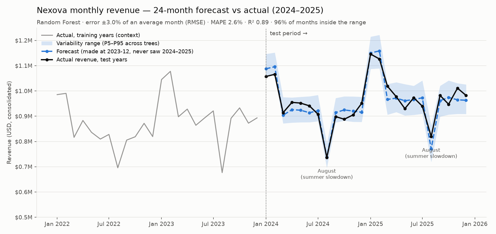

# Nexova sales forecast — feasibility model

**Question from Finance:** can we predict Nexova's monthly revenue for the coming months with an acceptable error, before we commit to an executive dashboard?

**Short answer:** yes, for this dataset. We trained the model on 2016–2023 only and stood at December 2023 to forecast all 24 months of 2024–2025. The forecast missed the real monthly revenue by **2.6% on average (MAPE)**, about **±$28.5k on a ~$959k month**. It ranked the months correctly, with August as the lowest month in both years, and 23 of the 24 actual months fell inside its variability range.

| | |
|---|---|
| Script | [`scripts/train_sales_forecast.py`](./train_sales_forecast.py) |
| Data | [`data/raw/nexova_sales.csv`](../data/raw/nexova_sales.csv): 120 `consolidated` rows, 2016-01 → 2025-12, used as provided |
| Test | [`tests/pipelines/test_sales_forecast.py`](../tests/pipelines/test_sales_forecast.py) |
| Outputs | [`data/eval/sales_forecast/`](../data/eval/sales_forecast/): `metrics.json`, `test_predictions.csv`, `forecast_vs_actual.png` |

```bash
uv sync                                              # first time only
uv run python scripts/train_sales_forecast.py        # train, evaluate, write outputs (~30 s)
uv run pytest tests/pipelines/test_sales_forecast.py -v
```



## Setup

- **Split:** the first 8 calendar years (2016-01 → 2023-12, 96 months) are used for training. The last 2 years (2024-01 → 2025-12, 24 months) are the test set and are never used for fitting. The unit tests enforce this.
- **Target:** `revenue_usd` of the `consolidated` row. Internally the model predicts `revenue / mean(previous 12 months)`, and that ratio is multiplied back into USD.
- **Headline evaluation is recursive.** The 24 test months are forecast in one go from December 2023, with each forecast fed back as the next month's history. No 2024–25 actual is ever used. A one-step-ahead variant (forecast next month knowing actuals up to last month) is also reported in `metrics.json`.
- **Seed:** `random_state=42`, so the runs are reproducible.

## Data preparation

- **Nulls and empties.** Blank lines are dropped and text is normalised. A null or non-positive `revenue_usd`, a duplicate month, or a missing month **raises an error** instead of being imputed. CONTEXT.md requires no missing months and positive revenue, and filling a gap would distort the August and Jan–Feb seasonality. The only nulls left come from the first 24 "warm-up" months, which are dropped because lag and rolling features can't exist there yet. That leaves 72 training rows (2018–2023).
- **Pattern check.** Before training, the script verifies the data matches CONTEXT.md:
  - August sits at 0.75–0.83× the annual average.
  - January and February sit at 1.14–1.19×.
  - Other months stay within ±5%.
  - Annual growth alternates between about 7% and 1%, always positive.
- **Scaling.** Revenue grows about 4% a year, so a 2016 month and a 2025 month have different magnitudes. Every revenue feature (and the target) is divided by the trailing 12-month mean, which makes them unit-free and comparable across years. Calendar features are already bounded. Tree models don't need standardisation, so no further scaler is applied.
- **Features (all causal, built only from earlier months):**
  - calendar: month, sin/cos of month, `is_august`, `is_jan_feb`
  - lags: 1, 2 and 12 months
  - 3-month rolling mean
  - 12-month coefficient of variation
  - trailing year-over-year growth (captures the alternating high/low growth years)
- **Leakage guard.** `active_contracts × avg_contract_value_usd` reproduces `revenue_usd` to within 0.3%. Same-month values of those columns would leak the answer, so they are **not** features.

## Why Random Forest instead of XGBoost

| Criterion | What we have | Leans toward |
|---|---|---|
| Data size | 72 training rows | **Random Forest.** Boosting overfits small data unless it's tuned carefully. |
| Explainability | Audience is the CEO, Sales and Finance | **Random Forest.** "300 trees vote, we average" fits in one sentence. Feature importances are in `metrics.json`; the top four are same-month-last-year, month, Jan–Feb and August. |
| Tuning time | Feasibility check, no tuning against the test years | **Random Forest.** Sound results with near-default settings. |
| Variability range | The ticket requires one | **Random Forest.** The spread across trees gives the band for free. |

Random Forest's weak spot is that trees can't predict above the highest value they saw in training. Revenue in 2024–25 exceeds anything in 2016–23, so we predict the scale-free ratio described above instead of raw USD.

## Results on the test set (2024–2025)

| Metric | Value | How to read it |
|---|---|---|
| **MSE** | 814,645,788 USD² | Average squared error. Its unit (USD²) can't be interpreted directly, so it's translated below. |
| RMSE | $28,542 = **2.98% of the average month** ($959,363) | The typical miss in dollars. This is MSE expressed as a share of monthly revenue. |
| MAPE | **2.61%** | Average % miss per month. This is the number to give Finance. |
| **R² score** | **0.891** | The share of month-to-month variation the forecast explains (1 = perfect, 0 = no better than predicting the average every month). |
| **Gini (normalised)** | **0.899** | How well the forecast ranks months from strongest to weakest (1 = perfect order, 0 = random). August came out lowest in both years. |
| **PSI**, seasonal ratio, train vs test | **0.058** | Stable (< 0.10). The seasonal shape of revenue in 2024–25 matches 2016–23, so the patterns the model learned still apply. |
| **PSI**, forecast vs actual distribution | 0.195 | Moderate (0.10–0.25). The averaged forecast is a bit smoother than reality and slightly compresses the extremes. |
| PSI, business-line mix | n/a | The CSV only has `consolidated` rows, so there's no per-line mix to compare. |
| Band coverage (P5–P95) | 96% (23/24 months) | The variability range is honest: it isn't too narrow. |
| One-step-ahead (reference) | MAPE 3.07%, R² 0.84, Gini 0.87 | A rolling monthly forecast performs about the same. |

PSI uses quantile bins with about 5+ observations per bin (4 bins for 24 test months). The textbook 10 bins on 24 points leaves ~2 points per bin, and PSI blows up from sampling noise alone.

## What each metric measures, and why a low MSE alone isn't enough

- **MSE** measures *how far off* the forecast is, in squared dollars. It is dominated by big months, it can't be explained in business terms, and it says nothing about *direction* or *shape*. A model that predicts a flat average every month can still post a modest MSE while completely missing August.
- **R²** compares the model with that flat-average baseline. A low MSE combined with a low R² means the model learned nothing beyond the mean.
- **Gini** measures *ranking*: does the forecast know which months will be strong and which weak? This is what Laura needs to tell a *normal* slow August from an *anomalous* drop. If the forecast already expects August to be ~20% down, an August that comes in on forecast is fine, and a March that comes in 20% down is the alarm. MSE can't tell you that.
- **PSI** measures *stability*: whether the data the model sees in production still looks like what it was trained on. Without it, a low test MSE could be luck on one period. A rising PSI is the early warning to retrain.

Together the four metrics show the error is small (MSE/RMSE), the model is better than a baseline (R²), it orders months correctly (Gini), and the patterns it learned still hold (PSI).

## Limitations

- The provided data has very regular seasonality, so real-world error will be higher. Re-run monthly and keep watching PSI.
- The forecast can only be as good as the history. A structural change (a new business line, a lost key client) won't be anticipated.
- The variability band reflects disagreement between trees, not every source of uncertainty. Treat it as a planning range, not a guarantee.
